# BrokerPilot

Platformă AI pentru brokeri de asigurări. Clientul face constatarea amiabilă de pe telefon sau vorbește cu un asistent vocal. Brokerul primește dosarul complet, verificat, pe Telegram și în dashboard.

> Toate datele din capturi sunt fictive. Actele sunt marcate SPECIMEN.

## Clientul

<table>
<tr>
<td width="33%" valign="top"><b>Start sau apel cu asistentul</b><br>Ana (Vapi) răspunde, caută dosarul sau deschide unul nou. Se prezintă ca AI; la răniți trimite la 112.</td>
<td width="33%" valign="top"><b>Acte: înainte de poză</b><br>Clientul bifează acordul, apoi fotografiază talonul și polița.</td>
<td width="33%" valign="top"><b>Acte: după citirea AI</b><br>Gemini completează câmpurile; clientul doar confirmă sau corectează.</td>
</tr>
<tr>
<td>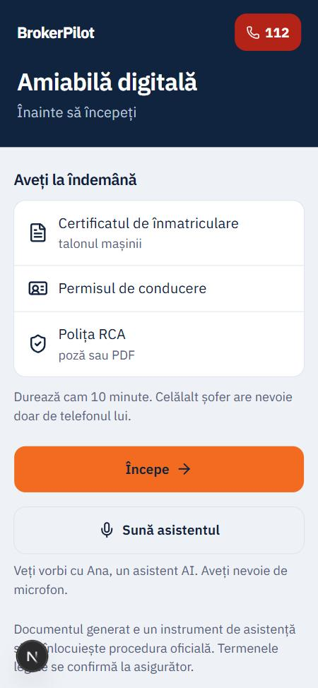</td>
<td>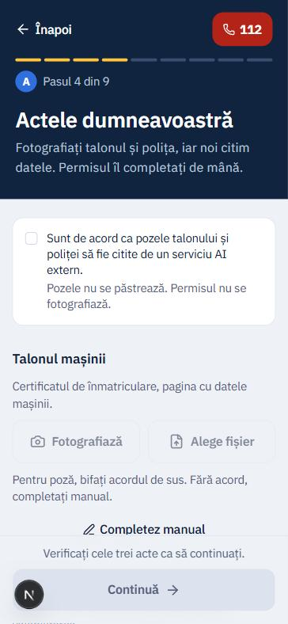</td>
<td>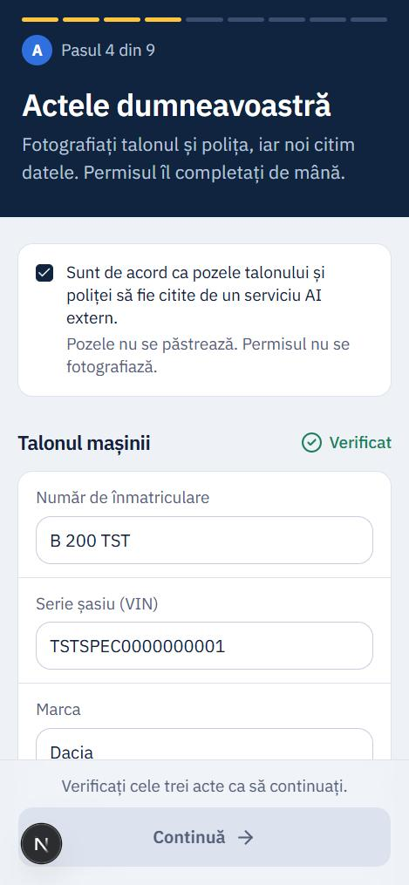</td>
</tr>
</table>

Ce citește modelul din poza talonului (răspuns real pe un act SPECIMEN):

```json
{ "plate": { "value": "B 200 TST",        "confidence": 1 },
  "vin":   { "value": "TSTSPEC000000001", "confidence": 0.5 },
  "make":  { "value": "Dacia",            "confidence": 1 } }
```

Fiecare câmp are un scor de încredere; ce nu se poate citi devine `null`. Aici VIN-ul are o cifră lipsă, iar modelul a marcat-o singur cu 0,5. Validatorii locali și ecranul de confirmare prind astfel de greșeli.

## Brokerul

<table>
<tr>
<td width="33%" valign="top"><b>Dosar nou pe Telegram</b><br>n8n trimite rezumatul și PDF-ul, cu butoanele „Preiau” și „Cere info lipsă”.</td>
<td width="33%" valign="top"><b>Comenzi</b><br><code>/dosare</code> arată dosarele deschise.</td>
<td width="33%" valign="top"><b>Întrebări din documente</b><br><code>/intreaba</code> răspunde doar din surse, cu citări [document, pagină].</td>
</tr>
<tr>
<td>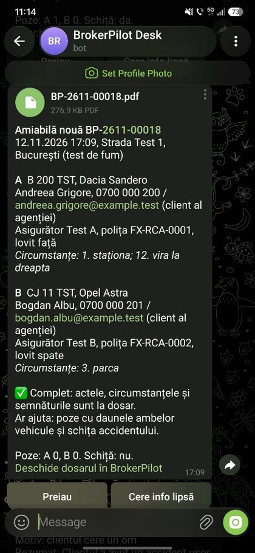</td>
<td>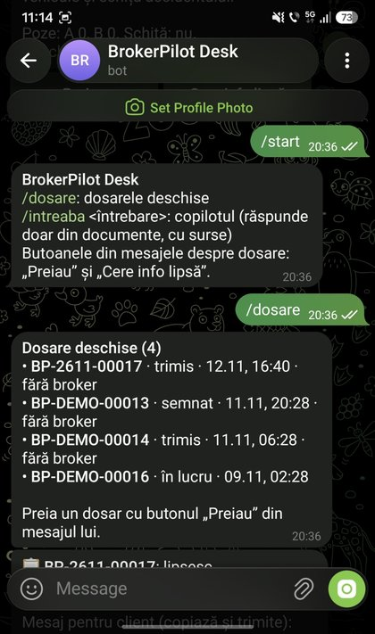</td>
<td>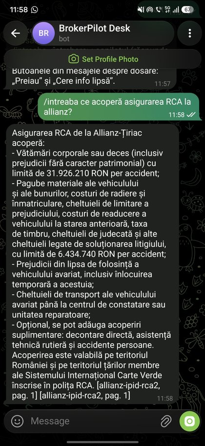</td>
</tr>
</table>

**Dashboard:** dosare, clienți, reînnoiri, apeluri, cu fișa comparativă a șoferilor A | B.

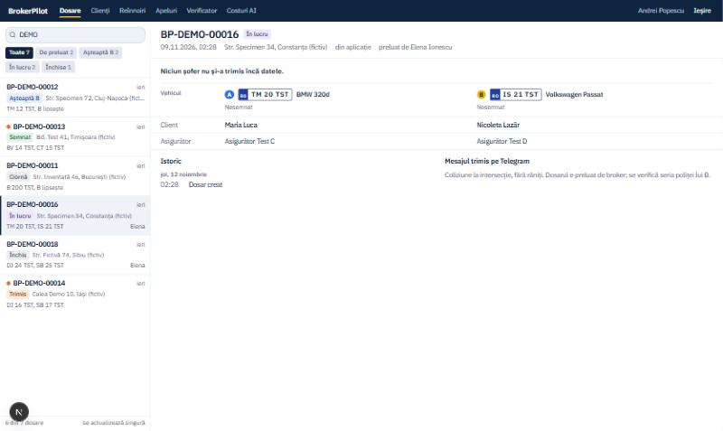

**Verificatorul de documente:** reguli fixe (sume, date, CNP, nume comparat cu clientul) și sugestii AI pentru ce nu prind regulile. Brokerul acceptă sau respinge fiecare punct.

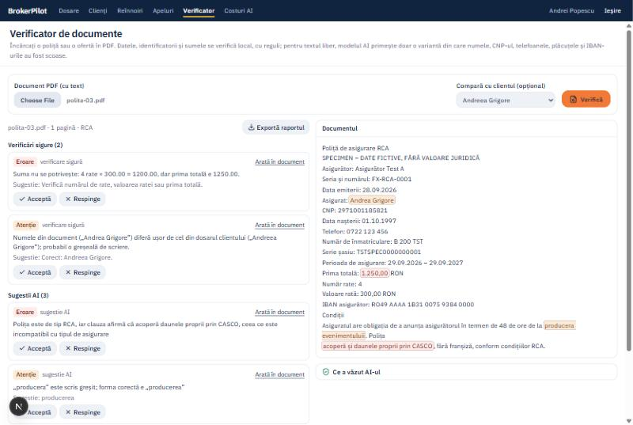

„Ce a văzut AI-ul” arată textul exact trimis modelului, cu datele personale înlocuite:

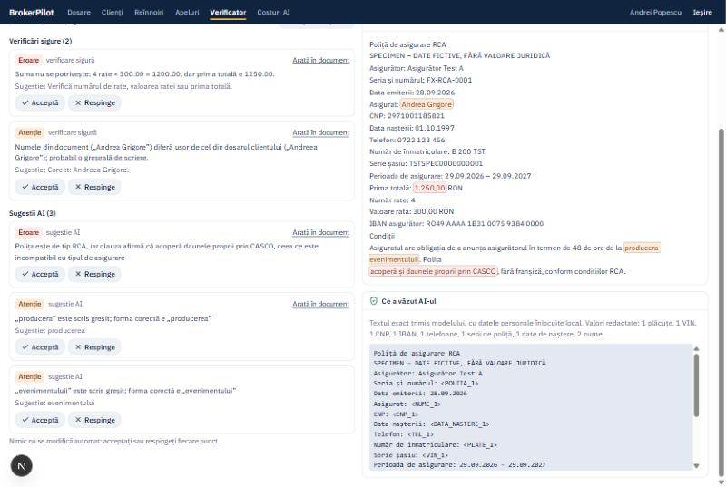

**Costuri AI:** fiecare apel, cu tokeni, cost estimat și plafonul zilnic.

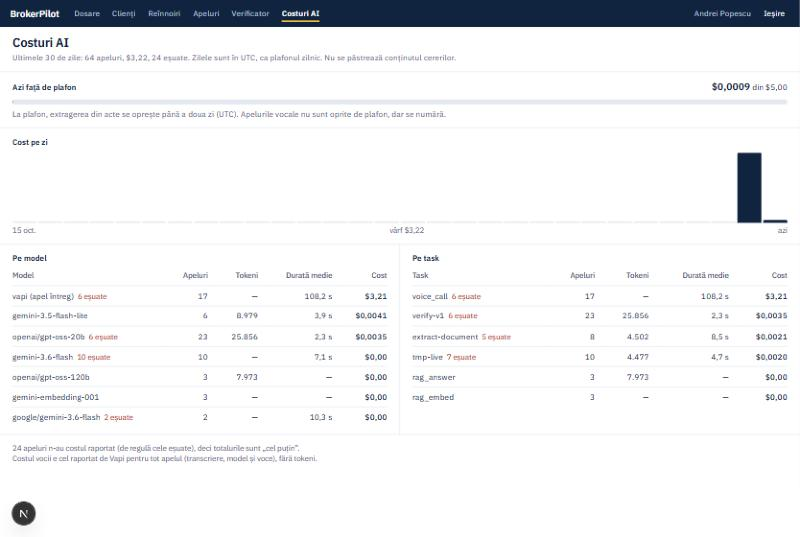

## Cum funcționează AI-ul

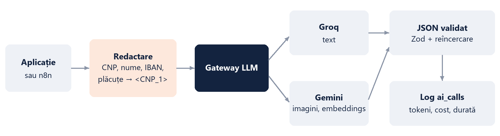

- **Un singur gateway** pentru toate apelurile LLM ([`gateway.ts`](apps/web/lib/ai/gateway.ts)): model de rezervă, plafon zilnic de cost, log în `ai_calls`.
- **Datele personale nu ajung la LLM** în fluxurile brokerului: CNP, nume, telefon, IBAN și plăcuțe se înlocuiesc local ([`lib/verify/redact.ts`](apps/web/lib/verify/redact.ts)). Excepție: pozele actelor din wizard, cu acordul clientului.
- **Output strict:** JSON Schema + Zod, cu o reîncercare la format greșit.
- **Modele:** Groq (text: verificator, RAG), Gemini (citirea actelor, embeddings), Vapi (voce).

**RAG** (n8n `WF08` + `WF04`):

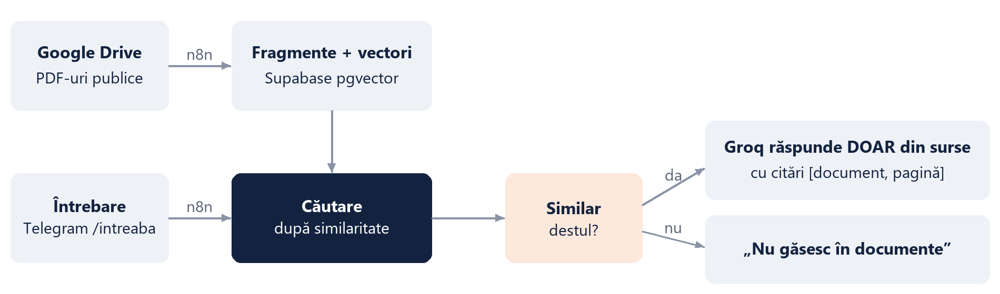

## Stack și structură

Next.js (App Router, TypeScript, Tailwind, shadcn/ui, Zod) · Supabase (Postgres, pgvector, Storage, Auth, Realtime, RLS) · n8n self-hosted în Docker · Vapi · Telegram.

| Folder | Conținut |
|---|---|
| `apps/web` | aplicația: wizardul clientului, dashboard-ul brokerului, API-uri |
| `n8n/workflows` | `WF01` dosar nou → Telegram, `WF02`/`WF03` unelte și final de apel Vapi, `WF04` RAG, `WF05` botul brokerului, `WF08` ingestie Drive, `WF99` erori |
| `supabase` | migrări și seed |
| `prompts` | promptul asistentului vocal |
| `data/fixtures` | date fictive și acte SPECIMEN |
| `scripts` | fixtures, import/export n8n, smoke test, configurare Vapi |
| `infra` | docker-compose |

## Rulare locală

Node 22+, apoi `.env` după `.env.example`.

```bash
npm ci
npm run dev        # http://localhost:3000
npm test           # vitest
npm run lint && npm run typecheck
```
